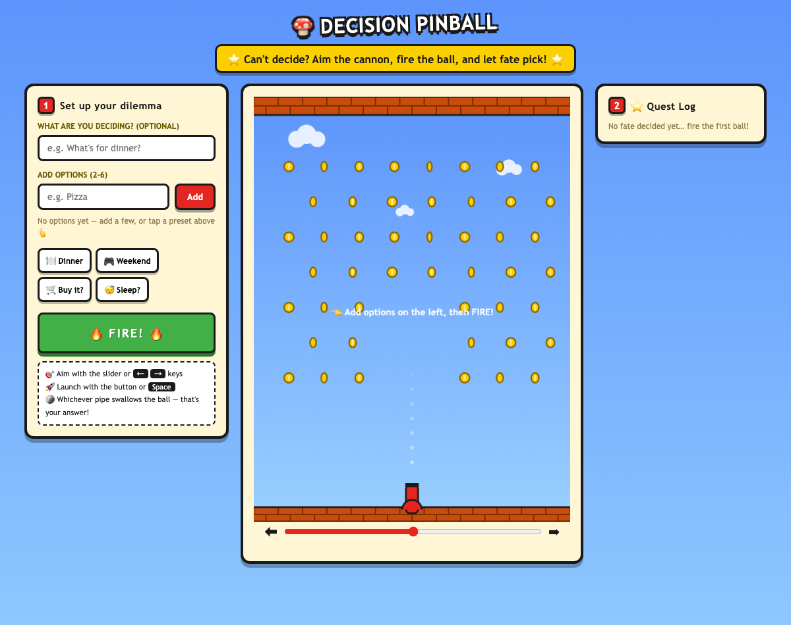

# Decision Pinball 🍄

An interactive experience built for Assignment 3.

## The idea

**Decision Pinball** is a Mario-style cannon machine for people who can't make up their minds. Instead of scoring points, the ball decides things for you.

- **Intended user:** anyone with decision fatigue — people stuck on small daily dilemmas like "what's for dinner", "should I buy it", "should I sleep now".
- **Main interaction:** the user types a question (optional), adds 2–6 options (or taps a one-click preset), **aims the cannon at the bottom of the board** with a slider or the arrow keys, and **fires** (button or Space). The ball launches upward, bounces through a field of spinning gold coins, and eventually falls into one of the green pipes at the bottom — each pipe is labeled with one of the user's options. Whichever pipe swallows the ball is the answer.
- **Why a cannon and not a random button:** aiming is a deliberate input, the flight is long enough to build suspense, and watching the ball bounce off coins, nearly fall into one pipe and then tip into another makes the answer feel earned rather than generated.

## The interaction loop

1. **Input** — type a question, add options, and aim the cannon (slider or arrow keys).
2. **Response** — a physics-simulated ball is launched from the bottom cannon; the pipes at the bottom are generated from the user's own options (2–6), so the board physically rearranges around what you type.
3. **Feedback** — coin "ding" on every peg hit, a launch sound, a warp sound + particle burst when the ball is swallowed, the winning pipe flashes, and the answer appears in a golden result block.
4. **Next action** — "PLAY AGAIN" to reroll (a different aim changes the trajectory), edit options, or check the ⭐ Quest Log of past decisions.

## Error handling

- Empty or duplicate option → toast message, input is not added.
- Fewer than 2 options when firing → toast "Add at least 2 options first!".
- Firing while the ball is in the air → toast "The ball is still in the air — patience!".
- Removing options mid-flight → blocked with a toast until the ball lands.
- Keyboard controls (Space / arrows) are ignored while the user is typing in a text field.
- Ball getting stuck on a coin (rare physics edge case) → automatic "nudge" kicks it loose; a second failsafe handles balls loitering in the cannon gap.
- Endless bouncing → the ball "gets tired": after ~8 seconds of flight gravity gradually ramps up, so every round is guaranteed to end in a pipe.
- Sound uses WebAudio and is created only after the first user gesture (browser autoplay policy); if audio is unavailable, the experience works silently.

## Mario-style visual design

The whole page uses a playful game aesthetic: Mario sky-blue background with drifting clouds, brick ceiling and ground, spinning gold coins as bumpers, green warp pipes as answer slots, a chunky outlined cannon with an aiming guide, and thick-border "game UI" panels with press-down buttons. No images are used — every visual is drawn with Canvas or CSS, and every sound is synthesized with the Web Audio API.

## How to run

No dependencies, no build step — it is a single self-contained `index.html` using only vanilla HTML/CSS/JS and the Canvas API.

Option A: double-click `index.html` to open it in a browser.

Option B (recommended, matches how it was tested):

```bash
cd decision-pinball
python3 -m http.server 8000
# open http://localhost:8000
```

## Known limitations

- The landing pipe is determined by real (slightly randomized) physics, so it is not "fair" — that's part of the charm, but use it for fun dilemmas, not important ones.
- Option labels longer than 14 characters wrap/truncate on the pipes.
- Sound requires the browser to allow WebAudio (all modern browsers do).

## Screenshots / demo

**▶ Play it live:** https://decision-pinball.app.workbuddy.host/?sharecode=IJYOOZD4ZP



*(Optional: replace with your own screenshot of a landing moment, and/or add a short screen recording for the sound.)*

## Companion piece

An earlier companion exploration for the same brief: **VINYL STATIC** 🎧 — an interactive vinyl record driven by your voice and motion, where interaction is a continuous performance rather than an aim-and-fire game.

- Live: https://yinzhulei333-lab.github.io/vinyl-static/
- Source: https://github.com/yinzhulei333-lab/vinyl-static

## Credits

- All code written from scratch for this assignment (with AI assistance — see PROCESS.md).
- No external libraries, images, fonts, or audio files. All visuals are Canvas/CSS drawing; all sounds are synthesized with the Web Audio API. Inspired by the general look of classic Mario games; no copyrighted assets are used.
